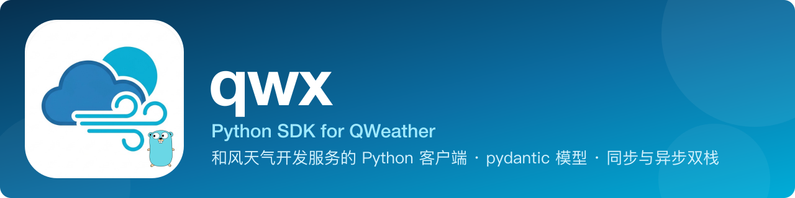

<p align="center">
  
</p>

<p align="center">
  <a href="https://github.com/KanoCifer/qwx-py/actions/workflows/ci.yml" target="_blank" rel="noopener"></a>
  <a href="https://pypi.org/project/qwx/" target="_blank" rel="noopener"></a>
  <a href="https://pypi.org/project/qwx/" target="_blank" rel="noopener"></a>
  <a href="https://github.com/KanoCifer/qwx-py/blob/main/LICENSE" target="_blank" rel="noopener"></a>
  <a href="https://github.com/KanoCifer/qwx-py#endpoints" target="_blank" rel="noopener"></a>
  <a href="https://github.com/KanoCifer/qwx-py#endpoints" target="_blank" rel="noopener"></a>
  <a href="https://github.com/KanoCifer/qwx" target="_blank" rel="noopener"></a>
</p>

<p align="center">
  <a href="README.md"><b>简体中文</b></a> · <a href="README_EN.md">English</a>
</p>

qwx 是社区维护的 Python SDK，覆盖和风天气（QWeather）上游文档中的核心接口族，返回 pydantic v2 模型。

Python 版与 Go 版（[KanoCifer/qwx](https://github.com/KanoCifer/qwx)）语义对等：端点集合、缓存键字节、端点常量值、错误分类与 TTL 优先级完全一致。缓存值存原始 JSON bytes，两边共享同一个 Redis 时键和值都互通。

---

<details>
<summary><b>📖 目录</b></summary>

- [✨ 特性](#features)
- [📦 安装](#installation)
- [🚀 快速开始](#quick-start)
- [📖 使用指南](#guide)
  - [🔑 认证](#authentication)
  - [⚙️ 客户端选项](#client-options)
  - [📍 位置](#location)
  - [🗄️ 缓存与 TTL](#caching)
  - [📝 日志](#logging)
  - [🚨 错误处理](#errors)
  - [⏱️ 并发与超时](#concurrency)
  - [🧪 测试](#testing)
- [🔌 支持的接口](#endpoints)
- [📚 文档](#docs)
- [🔗 官方文档](#upstream-docs)
- [⚖️ 许可](#license)

</details>

---

<a id="features"></a>
## ✨ 特性

- **26 个端点**，覆盖天气、空气质量、预警、太阳辐射、GeoAPI、控制台、天文、历史天气、生活指数、分钟级降水、台风、潮汐十二个资源族。
- **同步与异步双栈**（httpx）：端点方法体只写一份，同步客户端返回模型，异步客户端返回协程。
- **pydantic v2 模型**：上游新增字段不会被丢弃，未知字段保留在 `model_extra` 里。
- **缓存键与 Go 版逐字相同**：字面量是已发布事实，改了会让已写入的缓存条目全部失效。
- **客户端先校验**：参数越界与位置形态非法在本地抛异常，不打上游。
- **错误分层**：按异常类型判断，不解析错误字符串。

---

<a id="installation"></a>
## 📦 安装

```bash
pip install qwx
```

要求 Python 3.10 及以上。依赖 `httpx`、`pydantic`、`cryptography`（JWT 签名）。

需要 Redis 缓存时装可选 extra：

```bash
pip install "qwx[redis]"
```

从源码装：

```bash
git clone https://github.com/KanoCifer/qwx-py.git
cd qwx-py
pip install -e ".[dev]"
```

---

<a id="quick-start"></a>
## 🚀 快速开始

三步：创建认证、创建基础客户端、创建接口族的客户端。

### 同步

```python
import qwx
from qwx.v1.weather import WeatherService

# 1. 认证。JWT 用控制台分配的凭据，API KEY 用 qwx.APIKeyAuth。
auth = qwx.JWTAuth(
    private_key_pem=open("ed25519-private.pem", encoding="utf-8").read(),
    key_id="YOUR_KEY_ID",
    project_id="YOUR_PROJECT_ID",
    developer_id="YOUR_DEVELOPER_ID",  # 必填，控制台「设置」页
)

# 2. 基础客户端。api_host 是控制台「设置」页分配的专属 Host，必填。
with qwx.Client(auth, "abcxyz.qweatherapi.com") as client:
    # 3. 接口族的客户端。
    weather = WeatherService(client)
    result = weather.current(qwx.Location(lat=39.92, lon=116.41))
    print(result.condition.text, result.temperature.value, result.temperature.unit)
```

`Client` 是上下文管理器，`with` 退出时关闭底层 HTTP 连接。不需要上下文管理时自己调 `client.close()`。

### 异步

异步版方法同名，返回协程：

```python
import asyncio

import qwx
from qwx.v1.weather import AsyncWeatherService


async def main() -> None:
    auth = qwx.APIKeyAuth("YOUR_API_KEY")
    async with qwx.AsyncClient(auth, "abcxyz.qweatherapi.com") as client:
        weather = AsyncWeatherService(client)
        result = await weather.current(qwx.Location(lat=39.92, lon=116.41))
        print(result.condition.text)


asyncio.run(main())
```

### 可运行示例

`examples/` 下有四个脚本，读环境变量后直接跑：

| 脚本 | 内容 |
| --- | --- |
| `examples/basic_sync.py` | API KEY 认证，取实时天气 |
| `examples/basic_async.py` | 异步版 |
| `examples/jwt_auth.py` | JWT 认证 |
| `examples/cache_redis.py` | 接 Redis 缓存 |

```bash
QWX_API_KEY=YOUR_API_KEY QWX_API_HOST=your-host.qweatherapi.com python examples/basic_sync.py
```

---

<a id="guide"></a>
## 📖 使用指南

<a id="authentication"></a>
### 🔑 认证

两种认证任选其一，不能同时使用。

```python
auth = qwx.APIKeyAuth("YOUR_API_KEY")

auth = qwx.JWTAuth(
    private_key_pem=open("ed25519-private.pem", encoding="utf-8").read(),
    key_id="YOUR_KEY_ID",
    project_id="YOUR_PROJECT_ID",
    developer_id="YOUR_DEVELOPER_ID",
)
```

JWT 用 Ed25519 私钥签 EdDSA 令牌，有效期 15 分钟，客户端在过期前自动换新。私钥生成：

```bash
openssl genpkey -algorithm ED25519 -out ed25519-private.pem
```

官方已公告：从 2027 年 1 月 1 日起限制用 API KEY 认证的每日请求量，且 SDK 5+ 不再支持 API KEY。新项目建议用 JWT。配置与排障顺序见 [docs/auth.md](docs/auth.md)。

<a id="client-options"></a>
### ⚙️ 客户端选项

```python
client = qwx.Client(
    auth,
    "abcxyz.qweatherapi.com",
    timeout=30.0,  # 单请求超时（秒）
    cache=cache,  # 缓存实现，默认 None
    ttl_policy=policy,  # 按端点决定缓存时长
    logger=logger,  # 标准库 logging 的 logger
    http_client=httpx.Client(...),  # 自定义 httpx 客户端
)
```

`api_host` 没有默认值：公共域名已陆续停服，必须用控制台「设置」页分配的专属 Host。

<a id="location"></a>
### 📍 位置

```python
qwx.Location(lat=39.92, lon=116.41)  # 坐标对
qwx.Location(id="101010100")  # LocationID
qwx.Location(name="杭州")  # 地名，只有 GeoAPI 认
qwx.parse_location("116.41,39.92")  # 从字符串解析：经度在前
```

新一代端点（`/weather/v1/*` 等）的路径参数是**纬度在前**；v7 与 GeoAPI 的查询参数是**经度在前**。写反了上游直接 400。位置形态按端点不同，详见 [docs/endpoints.md](docs/endpoints.md)。

<a id="caching"></a>
### 🗄️ 缓存与 TTL

不传 `cache` 时每次请求都打到上游。缓存接口只有两个方法，自己实现即可：

```python
from datetime import timedelta
from typing import Protocol


class Cache(Protocol):
    def get(self, key: str) -> bytes | None: ...
    def set(self, key: str, data: bytes, ttl: timedelta) -> None: ...
```

内置 `qwx.MemoryCache` 只适合测试与单实例临时缓存（没有后台清理，长期运行内存只增不减）。生产环境用共享缓存：

```python
from qwx.redis_cache import RedisCache

cache = RedisCache.from_url("redis://127.0.0.1:6379/0")
client = qwx.Client(auth, "abcxyz.qweatherapi.com", cache=cache)
```

缓存值是原始 JSON bytes，与 Go 版共享同一个 Redis 时键和值都互通。

TTL 三级优先级：单次覆盖 > `TTLPolicy` > 端点默认时长。

```python
from datetime import timedelta

import qwx
from qwx.v1.weather import EndpointCurrent

policy = qwx.TTLMap({EndpointCurrent: timedelta(seconds=30)})  # 实况只缓存 30 秒
client = qwx.Client(auth, "abcxyz.qweatherapi.com", cache=cache, ttl_policy=policy)

with client.override_ttl(timedelta(0)):  # 这一次不读也不写缓存
    weather.current(loc)
```

键的形状、TTL 表与接自己的缓存见 [docs/caching.md](docs/caching.md)。

<a id="logging"></a>
### 📝 日志

不注入 logger 时不输出任何日志。注入标准库 `logging` 的 logger：

```python
import logging

import qwx

logger = logging.getLogger("qwx")
logger.setLevel(logging.INFO)

client = qwx.Client(auth, "abcxyz.qweatherapi.com", logger=logger)
```

字段名：`endpoint`、`method`、`path`、`status`、`duration_ms`、`cache_key`、`attempt`、`error`、`upstream_code`、`upstream_title`。日志里没有认证凭据与响应体，查询参数也不记录。详见 [docs/logging.md](docs/logging.md)。

<a id="errors"></a>
### 🚨 错误处理

异常层级：

```
QwxError
├── InvalidConfigError      构造参数有问题
├── InvalidLocationError    位置形态非法
├── InvalidParameterError   参数越界
├── InvalidResponseError    响应不是合法 JSON
└── UpstreamError
    ├── UpstreamRejectedError     上游 4xx
    ├── QuotaExceededError        上游 429
    ├── UnauthorizedError         上游 401 / 403
    └── UpstreamUnavailableError  上游 5xx 或网络错误
```

按类型判断，不解析错误字符串：

```python
import qwx

try:
    result = weather.current(loc)
except qwx.UnauthorizedError:
    ...  # 查凭据，见 docs/auth.md
except qwx.QuotaExceededError:
    ...  # 退避后重试
except qwx.InvalidParameterError:
    ...  # 修请求
except qwx.UpstreamError as exc:
    print(exc.status_code, exc.code, exc.title, exc.invalid_params, exc.body)
```

前四类在本地抛出，不打上游。上游 5xx、429 与网络错误时客户端自己带退避重试（首次之外最多 3 次）。详见 [docs/errors.md](docs/errors.md)。

<a id="concurrency"></a>
### ⏱️ 并发与超时

`Client` 与 `AsyncClient` 无状态，可并发共享。默认单请求超时 30 秒；需要代理、连接池或自定义证书时注入自己的 httpx 客户端：

```python
import httpx

import qwx

http = httpx.Client(
    timeout=httpx.Timeout(10.0, connect=3.0), limits=httpx.Limits(max_connections=50)
)
client = qwx.Client(auth, "abcxyz.qweatherapi.com", http_client=http)
```

异步版同理，注入 `httpx.AsyncClient`。

<a id="testing"></a>
### 🧪 测试

```bash
pytest tests/ -q        # 单元测试，不打上游
pytest live -q          # 联网冒烟，需要真实凭据，缺凭据时整份跳过
```

联网冒烟要环境变量：`QWX_API_HOST` 必填，认证用 `QWX_API_KEY` 或 `QWX_JWT_PRIVATE_KEY` + `QWX_KEY_ID` + `QWX_PROJECT_ID` + `QWX_DEVELOPER_ID`。详见 [docs/verification.md](docs/verification.md)。

---

<a id="endpoints"></a>
## 🔌 支持的接口

26 个端点，与 [docs/endpoints.md](docs/endpoints.md) 一一对应（那里有位置形态、默认 TTL、缓存键模板）。

| 模块 | 方法 | 上游接口 | 端点常量 |
| --- | --- | --- | --- |
| `qwx.console` | `finance` | `GET /finance/v1/summary` | `qwx.console.EndpointFinance` |
| `qwx.console` | `stats` | `GET /metrics/v1/stats` | `qwx.console.EndpointStats` |
| `qwx.geo` | `lookup_city` | `GET /geo/v2/city/lookup` | `qwx.geo.EndpointCity` |
| `qwx.geo` | `lookup_poi` | `GET /geo/v2/poi/lookup` | `qwx.geo.EndpointPOI` |
| `qwx.geo` | `poi_range` | `GET /geo/v2/poi/range` | `qwx.geo.EndpointPOIRange` |
| `qwx.geo` | `top_cities` | `GET /geo/v2/city/top` | `qwx.geo.EndpointTopCities` |
| `qwx.v1.airquality` | `current` | `GET /airquality/v1/current/{lat}/{lon}` | `qwx.v1.airquality.EndpointCurrent` |
| `qwx.v1.airquality` | `daily` | `GET /airquality/v1/daily/{lat}/{lon}` | `qwx.v1.airquality.EndpointDaily` |
| `qwx.v1.airquality` | `hourly` | `GET /airquality/v1/hourly/{lat}/{lon}` | `qwx.v1.airquality.EndpointHourly` |
| `qwx.v1.airquality` | `station` | `GET /airquality/v1/stations/{stationID}` | `qwx.v1.airquality.EndpointStation` |
| `qwx.v1.alert` | `current` | `GET /weatheralert/v1/current/{lat}/{lon}` | `qwx.v1.alert.Endpoint` |
| `qwx.v1.solarradiation` | `forecast` | `GET /solarradiation/v1/forecast/{lat}/{lon}` | `qwx.v1.solarradiation.Endpoint` |
| `qwx.v1.weather` | `current` | `GET /weather/v1/current/{lat}/{lon}` | `qwx.v1.weather.EndpointCurrent` |
| `qwx.v1.weather` | `hourly` | `GET /weather/v1/hourly/{lat}/{lon}` | `qwx.v1.weather.EndpointHourly` |
| `qwx.v1.weather` | `daily` | `GET /weather/v1/daily/{lat}/{lon}` | `qwx.v1.weather.EndpointDaily` |
| `qwx.v7.astronomy` | `sun` | `GET /v7/astronomy/sun` | `qwx.v7.astronomy.EndpointSun` |
| `qwx.v7.astronomy` | `moon` | `GET /v7/astronomy/moon` | `qwx.v7.astronomy.EndpointMoon` |
| `qwx.v7.astronomy` | `solar_elevation_angle` | `GET /v7/astronomy/solar-elevation-angle` | `qwx.v7.astronomy.EndpointAngle` |
| `qwx.v7.historical` | `weather` | `GET /v7/historical/weather` | `qwx.v7.historical.Endpoint` |
| `qwx.v7.indices` | `indices` | `GET /v7/indices/{days}d` | `qwx.v7.indices.Endpoint` |
| `qwx.v7.indices` | `indices_multi` | `GET /v7/indices/{days}d` | `qwx.v7.indices.Endpoint` |
| `qwx.v7.minutely` | `minutely` | `GET /v7/minutely/5m` | `qwx.v7.minutely.Endpoint` |
| `qwx.v7.ocean` | `tide` | `GET /v7/ocean/tide` | `qwx.v7.ocean.Endpoint` |
| `qwx.v7.storm` | `list` | `GET /v7/tropical/storm-list` | `qwx.v7.storm.EndpointList` |
| `qwx.v7.storm` | `forecast` | `GET /v7/tropical/storm-forecast` | `qwx.v7.storm.EndpointForecast` |
| `qwx.v7.storm` | `track` | `GET /v7/tropical/storm-track` | `qwx.v7.storm.EndpointTrack` |

模块结构：

| 模块 | 承载 |
| --- | --- |
| `qwx` | 基础客户端、认证、缓存、`Location`、错误层级、两代共用的请求结构、`Refer`、`Metadata` |
| `qwx.v1` | 新一代跨端点族共用的基础类型（`Metadata`、`Value`、`Options`） |
| `qwx.v1.weather` | 新一代天气 `/weather/v1/*` |
| `qwx.v1.airquality` | 新一代空气质量 `/airquality/v1/*` |
| `qwx.v1.alert` | 预警 `/weatheralert/v1/*` |
| `qwx.v1.solarradiation` | 新一代太阳辐射预报 `/solarradiation/v1/*` |
| `qwx.v7.ocean` | 旧一代潮汐 `/v7/ocean/tide` |
| `qwx.v7.indices` | 旧一代生活指数 `/v7/indices/*` |
| `qwx.v7.minutely` | 旧一代分钟级降水 `/v7/minutely/*` |
| `qwx.v7.storm` | 台风 `/v7/tropical/*` |
| `qwx.v7.astronomy` | 天文 `/v7/astronomy/*` |
| `qwx.v7.historical` | 旧一代历史天气 `/v7/historical/weather` |
| `qwx.geo` | GeoAPI `/geo/v2/*` |
| `qwx.console` | 控制台 `/finance/v1/*`、`/metrics/v1/stats` |
| `qwx.redis_cache` | Redis 缓存实现（可选依赖 `qwx[redis]`） |

一个模块 = 一个上游资源族。两个例外：`geo` 的四个检索端点共享 `Place` 类型，`console` 的两个端点在上游归在同一页文档下、共享同一套响应骨架。

---

<a id="docs"></a>
## 📚 文档

| 场景 | 文档 |
| --- | --- |
| 接认证、配凭据、token 过期、401/403 | [docs/auth.md](docs/auth.md) |
| 写调用代码：参数上限、位置形态、返回类型、字段单位 | [docs/contract.md](docs/contract.md) |
| 上游行为与文档不符：400、空结果、时间对不上 | [docs/gotchas.md](docs/gotchas.md) |
| 决定重试与降级策略、读上游错误细节 | [docs/errors.md](docs/errors.md) |
| 接自己的缓存、调 TTL、排查缓存串味 | [docs/caching.md](docs/caching.md) |
| 接日志、排查请求记录 | [docs/logging.md](docs/logging.md) |
| 跑测试、联网冒烟 | [docs/verification.md](docs/verification.md) |
| 查全部端点：路径、位置形态、默认 TTL、缓存键模板 | [docs/endpoints.md](docs/endpoints.md) |

---

<a id="upstream-docs"></a>
## 🔗 官方文档

<https://dev.qweather.com/docs/>

---

<a id="license"></a>
## ⚖️ 许可

本包遵循 MIT 许可。

本包不是和风天气官方产品。使用上游数据需遵守[和风天气开发者许可协议](https://www.qweather.com/terms/developers-eula/)，展示天气数据时需保留上游返回的 attribution 信息。
