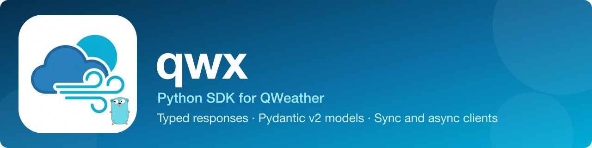

<p align="center">
  
</p>

<p align="center">
  <a href="https://github.com/KanoCifer/qwx-py/actions/workflows/ci.yml" target="_blank" rel="noopener"></a>
  <a href="https://pypi.org/project/qwx/" target="_blank" rel="noopener"></a>
  <a href="https://pypi.org/project/qwx/" target="_blank" rel="noopener"></a>
  <a href="https://github.com/KanoCifer/qwx-py/blob/main/LICENSE" target="_blank" rel="noopener"></a>
  <a href="https://github.com/KanoCifer/qwx-py#endpoints" target="_blank" rel="noopener"></a>
  <a href="https://github.com/KanoCifer/qwx-py#endpoints" target="_blank" rel="noopener"></a>
  <a href="https://github.com/KanoCifer/qwx" target="_blank" rel="noopener"></a>
</p>

<p align="center">
  <a href="README.md"><b>简体中文</b></a> · <a href="README_EN.md">English</a>
</p>

qwx is a community-maintained Python SDK that covers the core endpoint families in the upstream QWeather (和风天气) documentation and returns pydantic v2 models.

The Python version is semantically equivalent to the Go version ([KanoCifer/qwx](https://github.com/KanoCifer/qwx)): the same endpoint set, the same cache key bytes, the same endpoint constant values, the same error classification and the same TTL precedence. Cached values are stored as raw JSON bytes, so keys and values are interchangeable between the two versions when they share one Redis.

---

<details>
<summary><b>📖 Table of Contents</b></summary>

- [✨ Features](#features)
- [📦 Installation](#installation)
- [🚀 Quick start](#quick-start)
- [📖 Usage guide](#guide)
  - [🔑 Authentication](#authentication)
  - [⚙️ Client options](#client-options)
  - [📍 Location](#location)
  - [🗄️ Caching & TTL](#caching)
  - [📝 Logging](#logging)
  - [🚨 Error handling](#errors)
  - [⏱️ Concurrency & timeout](#concurrency)
  - [🧪 Testing](#testing)
- [🔌 Supported endpoints](#endpoints)
- [📚 Documentation](#docs)
- [🔗 Official documentation](#upstream-docs)
- [⚖️ License](#license)

</details>

---

<a id="features"></a>
## ✨ Features

- **26 endpoints** covering twelve resource families: weather, air quality, weather alerts, solar radiation, GeoAPI, console, astronomy, historical weather, life indices, minute-level precipitation, typhoons and tides.
- **Sync and async** (httpx): the endpoint method bodies are written once, the sync client returns models and the async client returns coroutines.
- **pydantic v2 models**: fields newly added upstream are not dropped, unknown fields are kept in `model_extra`.
- **Cache keys byte-for-byte identical to the Go version**: the literals are a published fact, changing them invalidates every cache entry already written.
- **The client validates first**: out-of-range parameters and illegal location forms raise locally, without hitting the upstream.
- **Layered errors**: classified by exception type, never by parsing the error string.

---

<a id="installation"></a>
## 📦 Installation

```bash
pip install qwx
```

Requires Python 3.10 or newer. Depends on `httpx`, `pydantic` and `cryptography` (JWT signing).

Install the optional extra when you need the Redis cache:

```bash
pip install "qwx[redis]"
```

From source:

```bash
git clone https://github.com/KanoCifer/qwx-py.git
cd qwx-py
pip install -e ".[dev]"
```

---

<a id="quick-start"></a>
## 🚀 Quick start

Three steps: create the authentication, create the base client, create the service client for an endpoint family.

### Sync

```python
import qwx
from qwx.v1.weather import WeatherService

# 1. Authentication. JWTAuth uses the credentials assigned in the console,
#    API KEY uses qwx.APIKeyAuth.
auth = qwx.JWTAuth(
    private_key_pem=open("ed25519-private.pem", encoding="utf-8").read(),
    key_id="YOUR_KEY_ID",
    project_id="YOUR_PROJECT_ID",
    developer_id="YOUR_DEVELOPER_ID",  # required, console "Settings" page
)

# 2. Base client. api_host is the dedicated host assigned on the console
#    "Settings" page, and it is required.
with qwx.Client(auth, "abcxyz.qweatherapi.com") as client:
    # 3. Service client for the endpoint family.
    weather = WeatherService(client)
    result = weather.current(qwx.Location(lat=39.92, lon=116.41))
    print(result.condition.text, result.temperature.value, result.temperature.unit)
```

`Client` is a context manager: leaving the `with` block closes the underlying HTTP connection. Call `client.close()` yourself when you do not use the block.

### Async

The async methods have the same names and return coroutines:

```python
import asyncio

import qwx
from qwx.v1.weather import AsyncWeatherService


async def main() -> None:
    auth = qwx.APIKeyAuth("YOUR_API_KEY")
    async with qwx.AsyncClient(auth, "abcxyz.qweatherapi.com") as client:
        weather = AsyncWeatherService(client)
        result = await weather.current(qwx.Location(lat=39.92, lon=116.41))
        print(result.condition.text)


asyncio.run(main())
```

### Runnable examples

Four scripts under `examples/` read their configuration from the environment and run as they are:

| Script | Contents |
| --- | --- |
| `examples/basic_sync.py` | API KEY authentication, current weather |
| `examples/basic_async.py` | The async version |
| `examples/jwt_auth.py` | JWT authentication |
| `examples/cache_redis.py` | Redis-backed cache |

```bash
QWX_API_KEY=YOUR_API_KEY QWX_API_HOST=your-host.qweatherapi.com python examples/basic_sync.py
```

---

<a id="guide"></a>
## 📖 Usage guide

<a id="authentication"></a>
### 🔑 Authentication

Pick one of the two, they cannot be used together.

```python
auth = qwx.APIKeyAuth("YOUR_API_KEY")

auth = qwx.JWTAuth(
    private_key_pem=open("ed25519-private.pem", encoding="utf-8").read(),
    key_id="YOUR_KEY_ID",
    project_id="YOUR_PROJECT_ID",
    developer_id="YOUR_DEVELOPER_ID",
)
```

JWT signs an EdDSA token with an Ed25519 private key. The token is valid for 15 minutes and the client renews it automatically before it expires. Generate the private key with:

```bash
openssl genpkey -algorithm ED25519 -out ed25519-private.pem
```

The vendor has already announced that from January 1, 2027 the daily request volume of API KEY authentication is limited, and that SDK 5+ no longer supports API KEY. New projects should use JWT. See [docs/auth.md](docs/auth.md) for the configuration and troubleshooting order.

<a id="client-options"></a>
### ⚙️ Client options

```python
client = qwx.Client(
    auth,
    "abcxyz.qweatherapi.com",
    timeout=30.0,  # per-request timeout in seconds
    cache=cache,  # cache implementation, None by default
    ttl_policy=policy,  # decides the cache duration per endpoint
    logger=logger,  # a logger from the standard library logging
    http_client=httpx.Client(...),  # custom httpx client
)
```

`api_host` has no default: the public domains have been retired one after another, so you must use the dedicated host assigned on the console "Settings" page.

<a id="location"></a>
### 📍 Location

```python
qwx.Location(lat=39.92, lon=116.41)  # coordinate pair
qwx.Location(id="101010100")  # LocationID
qwx.Location(name="Hangzhou")  # place name, only GeoAPI accepts it
qwx.parse_location("116.41,39.92")  # parse from a string: longitude first
```

New-generation endpoints (`/weather/v1/*` and friends) take path parameters with **latitude first**; v7 and GeoAPI take query parameters with **longitude first**. Swapping them gets you a 400 from the upstream. The accepted location form differs per endpoint, see [docs/endpoints.md](docs/endpoints.md).

<a id="caching"></a>
### 🗄️ Caching & TTL

Without a `cache` argument every request goes to the upstream. The cache interface has two methods, so you can implement your own:

```python
from datetime import timedelta
from typing import Protocol


class Cache(Protocol):
    def get(self, key: str) -> bytes | None: ...
    def set(self, key: str, data: bytes, ttl: timedelta) -> None: ...
```

The built-in `qwx.MemoryCache` is only suitable for tests and single-instance scratch use (it has no background cleanup, so a long-running process only grows). Use a shared cache in production:

```python
from qwx.redis_cache import RedisCache

cache = RedisCache.from_url("redis://127.0.0.1:6379/0")
client = qwx.Client(auth, "abcxyz.qweatherapi.com", cache=cache)
```

Cached values are the raw JSON bytes, so keys and values are interchangeable with the Go version when both share one Redis.

TTL precedence: per-call override > `TTLPolicy` > the endpoint's default duration.

```python
from datetime import timedelta

import qwx
from qwx.v1.weather import EndpointCurrent

policy = qwx.TTLMap({EndpointCurrent: timedelta(seconds=30)})  # cache current weather for 30s
client = qwx.Client(auth, "abcxyz.qweatherapi.com", cache=cache, ttl_policy=policy)

with client.override_ttl(timedelta(0)):  # neither read nor write the cache this time
    weather.current(loc)
```

Key shape, the TTL table and writing your own cache: [docs/caching.md](docs/caching.md).

<a id="logging"></a>
### 📝 Logging

Nothing is logged unless you inject a logger. Any standard library `logging` logger works:

```python
import logging

import qwx

logger = logging.getLogger("qwx")
logger.setLevel(logging.INFO)

client = qwx.Client(auth, "abcxyz.qweatherapi.com", logger=logger)
```

Field names: `endpoint`, `method`, `path`, `status`, `duration_ms`, `cache_key`, `attempt`, `error`, `upstream_code`, `upstream_title`. No credentials and no response bodies are logged, and query parameters are not recorded either. See [docs/logging.md](docs/logging.md).

<a id="errors"></a>
### 🚨 Error handling

Exception hierarchy:

```
QwxError
├── InvalidConfigError      bad constructor arguments
├── InvalidLocationError    invalid location form
├── InvalidParameterError   parameter out of range
├── InvalidResponseError    response is not valid JSON
└── UpstreamError
    ├── UpstreamRejectedError     upstream 4xx
    ├── QuotaExceededError        upstream 429
    ├── UnauthorizedError         upstream 401 / 403
    └── UpstreamUnavailableError  upstream 5xx or network error
```

Classify by type, never by parsing the error string:

```python
import qwx

try:
    result = weather.current(loc)
except qwx.UnauthorizedError:
    ...  # check the credentials, see docs/auth.md
except qwx.QuotaExceededError:
    ...  # back off and retry
except qwx.InvalidParameterError:
    ...  # fix the request
except qwx.UpstreamError as exc:
    print(exc.status_code, exc.code, exc.title, exc.invalid_params, exc.body)
```

The first four are raised locally without hitting the upstream. On upstream 5xx, 429 and network errors the client retries with backoff on its own (up to 3 times besides the first attempt). See [docs/errors.md](docs/errors.md).

<a id="concurrency"></a>
### ⏱️ Concurrency & timeout

`Client` and `AsyncClient` are stateless and can be shared across concurrent tasks. The default per-request timeout is 30 seconds; inject your own httpx client when you need a proxy, a connection pool or custom certificates:

```python
import httpx

import qwx

http = httpx.Client(
    timeout=httpx.Timeout(10.0, connect=3.0), limits=httpx.Limits(max_connections=50)
)
client = qwx.Client(auth, "abcxyz.qweatherapi.com", http_client=http)
```

The async version works the same way, inject an `httpx.AsyncClient`.

<a id="testing"></a>
### 🧪 Testing

```bash
pytest tests/ -q        # unit tests, no upstream calls
pytest live -q          # live smoke test, needs real credentials, skipped entirely when they are missing
```

The live smoke test reads environment variables: `QWX_API_HOST` is required, authentication uses either `QWX_API_KEY` or `QWX_JWT_PRIVATE_KEY` + `QWX_KEY_ID` + `QWX_PROJECT_ID` + `QWX_DEVELOPER_ID`. See [docs/verification.md](docs/verification.md).

---

<a id="endpoints"></a>
## 🔌 Supported endpoints

26 endpoints, one to one with [docs/endpoints.md](docs/endpoints.md) (which also lists the location form, the default TTL and the cache key template).

| Module | Method | Upstream endpoint | Endpoint constant |
| --- | --- | --- | --- |
| `qwx.console` | `finance` | `GET /finance/v1/summary` | `qwx.console.EndpointFinance` |
| `qwx.console` | `stats` | `GET /metrics/v1/stats` | `qwx.console.EndpointStats` |
| `qwx.geo` | `lookup_city` | `GET /geo/v2/city/lookup` | `qwx.geo.EndpointCity` |
| `qwx.geo` | `lookup_poi` | `GET /geo/v2/poi/lookup` | `qwx.geo.EndpointPOI` |
| `qwx.geo` | `poi_range` | `GET /geo/v2/poi/range` | `qwx.geo.EndpointPOIRange` |
| `qwx.geo` | `top_cities` | `GET /geo/v2/city/top` | `qwx.geo.EndpointTopCities` |
| `qwx.v1.airquality` | `current` | `GET /airquality/v1/current/{lat}/{lon}` | `qwx.v1.airquality.EndpointCurrent` |
| `qwx.v1.airquality` | `daily` | `GET /airquality/v1/daily/{lat}/{lon}` | `qwx.v1.airquality.EndpointDaily` |
| `qwx.v1.airquality` | `hourly` | `GET /airquality/v1/hourly/{lat}/{lon}` | `qwx.v1.airquality.EndpointHourly` |
| `qwx.v1.airquality` | `station` | `GET /airquality/v1/stations/{stationID}` | `qwx.v1.airquality.EndpointStation` |
| `qwx.v1.alert` | `current` | `GET /weatheralert/v1/current/{lat}/{lon}` | `qwx.v1.alert.Endpoint` |
| `qwx.v1.solarradiation` | `forecast` | `GET /solarradiation/v1/forecast/{lat}/{lon}` | `qwx.v1.solarradiation.Endpoint` |
| `qwx.v1.weather` | `current` | `GET /weather/v1/current/{lat}/{lon}` | `qwx.v1.weather.EndpointCurrent` |
| `qwx.v1.weather` | `hourly` | `GET /weather/v1/hourly/{lat}/{lon}` | `qwx.v1.weather.EndpointHourly` |
| `qwx.v1.weather` | `daily` | `GET /weather/v1/daily/{lat}/{lon}` | `qwx.v1.weather.EndpointDaily` |
| `qwx.v7.astronomy` | `sun` | `GET /v7/astronomy/sun` | `qwx.v7.astronomy.EndpointSun` |
| `qwx.v7.astronomy` | `moon` | `GET /v7/astronomy/moon` | `qwx.v7.astronomy.EndpointMoon` |
| `qwx.v7.astronomy` | `solar_elevation_angle` | `GET /v7/astronomy/solar-elevation-angle` | `qwx.v7.astronomy.EndpointAngle` |
| `qwx.v7.historical` | `weather` | `GET /v7/historical/weather` | `qwx.v7.historical.Endpoint` |
| `qwx.v7.indices` | `indices` | `GET /v7/indices/{days}d` | `qwx.v7.indices.Endpoint` |
| `qwx.v7.indices` | `indices_multi` | `GET /v7/indices/{days}d` | `qwx.v7.indices.Endpoint` |
| `qwx.v7.minutely` | `minutely` | `GET /v7/minutely/5m` | `qwx.v7.minutely.Endpoint` |
| `qwx.v7.ocean` | `tide` | `GET /v7/ocean/tide` | `qwx.v7.ocean.Endpoint` |
| `qwx.v7.storm` | `list` | `GET /v7/tropical/storm-list` | `qwx.v7.storm.EndpointList` |
| `qwx.v7.storm` | `forecast` | `GET /v7/tropical/storm-forecast` | `qwx.v7.storm.EndpointForecast` |
| `qwx.v7.storm` | `track` | `GET /v7/tropical/storm-track` | `qwx.v7.storm.EndpointTrack` |

Module layout:

| Module | Contents |
| --- | --- |
| `qwx` | Base clients, authentication, cache, `Location`, error hierarchy, request structures shared by both generations, `Refer`, `Metadata` |
| `qwx.v1` | Base types shared across the new-generation endpoint families (`Metadata`, `Value`, `Options`) |
| `qwx.v1.weather` | New-generation weather `/weather/v1/*` |
| `qwx.v1.airquality` | New-generation air quality `/airquality/v1/*` |
| `qwx.v1.alert` | Weather alerts `/weatheralert/v1/*` |
| `qwx.v1.solarradiation` | New-generation solar radiation forecast `/solarradiation/v1/*` |
| `qwx.v7.ocean` | Legacy tide `/v7/ocean/tide` |
| `qwx.v7.indices` | Legacy life indices `/v7/indices/*` |
| `qwx.v7.minutely` | Legacy minute-level precipitation `/v7/minutely/*` |
| `qwx.v7.storm` | Typhoons `/v7/tropical/*` |
| `qwx.v7.astronomy` | Astronomy `/v7/astronomy/*` |
| `qwx.v7.historical` | Legacy historical weather `/v7/historical/weather` |
| `qwx.geo` | GeoAPI `/geo/v2/*` |
| `qwx.console` | Console `/finance/v1/*`, `/metrics/v1/stats` |
| `qwx.redis_cache` | Redis cache implementation (optional dependency `qwx[redis]`) |

One module = one upstream resource family. There are two exceptions: the four GeoAPI search endpoints share the `Place` type, and the two console endpoints live under one upstream documentation page and share one response skeleton.

---

<a id="docs"></a>
## 📚 Documentation

| Scenario | Document |
| --- | --- |
| Set up authentication, credentials, token expiry, 401/403 | [docs/auth.md](docs/auth.md) |
| Write calling code: parameter limits, location forms, return types, field units | [docs/contract.md](docs/contract.md) |
| Upstream behaviour contradicts the docs: 400, empty results, mismatched times | [docs/gotchas.md](docs/gotchas.md) |
| Decide on retries and degradation, read upstream error details | [docs/errors.md](docs/errors.md) |
| Plug in your own cache, tune TTL, debug cache mix-ups | [docs/caching.md](docs/caching.md) |
| Wire up logging, inspect request records | [docs/logging.md](docs/logging.md) |
| Run the tests, run the live smoke test | [docs/verification.md](docs/verification.md) |
| Look up every endpoint: path, location form, default TTL, cache key template | [docs/endpoints.md](docs/endpoints.md) |

---

<a id="upstream-docs"></a>
## 🔗 Official documentation

<https://dev.qweather.com/docs/>

---

<a id="license"></a>
## ⚖️ License

This package is released under the MIT license.

This package is not an official QWeather product. Using upstream data is subject to the [QWeather Developer EULA](https://www.qweather.com/terms/developers-eula/), and the attribution returned by the upstream must be kept when displaying weather data.
